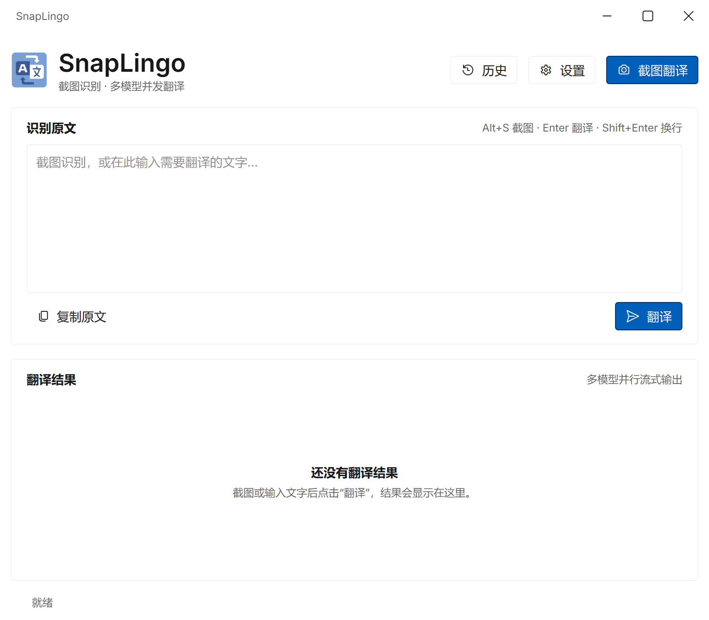
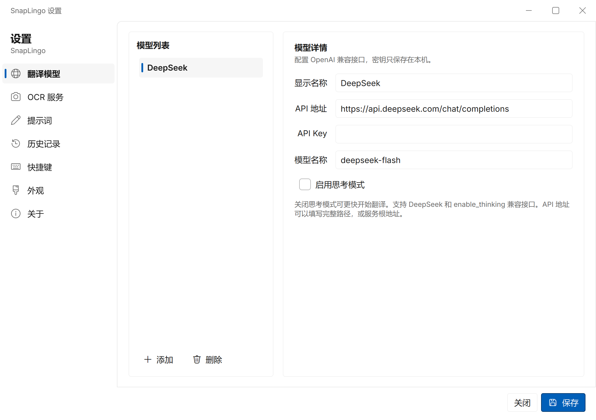
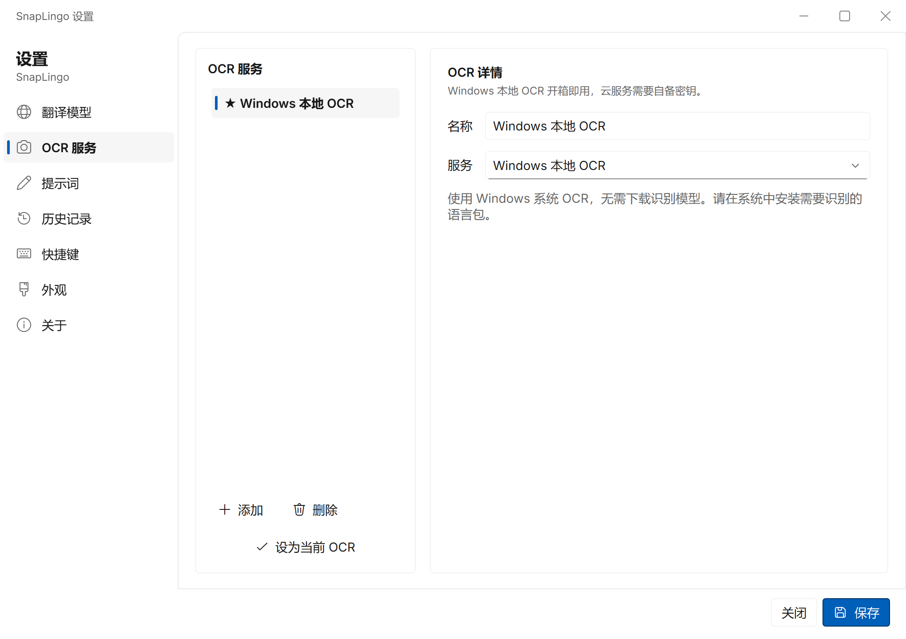
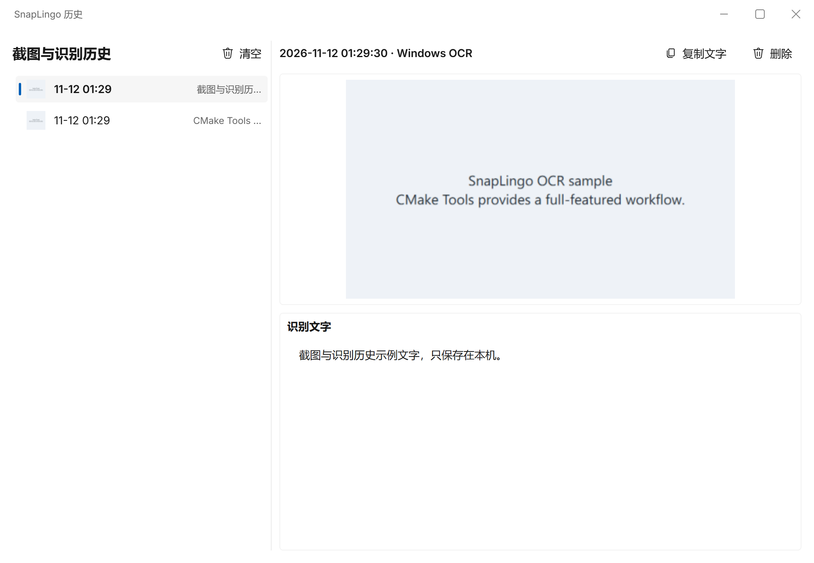
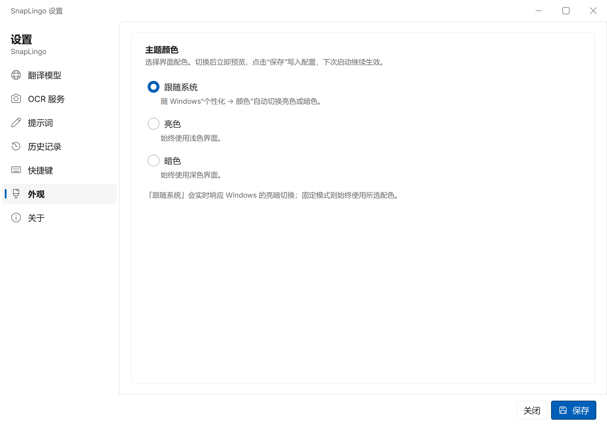
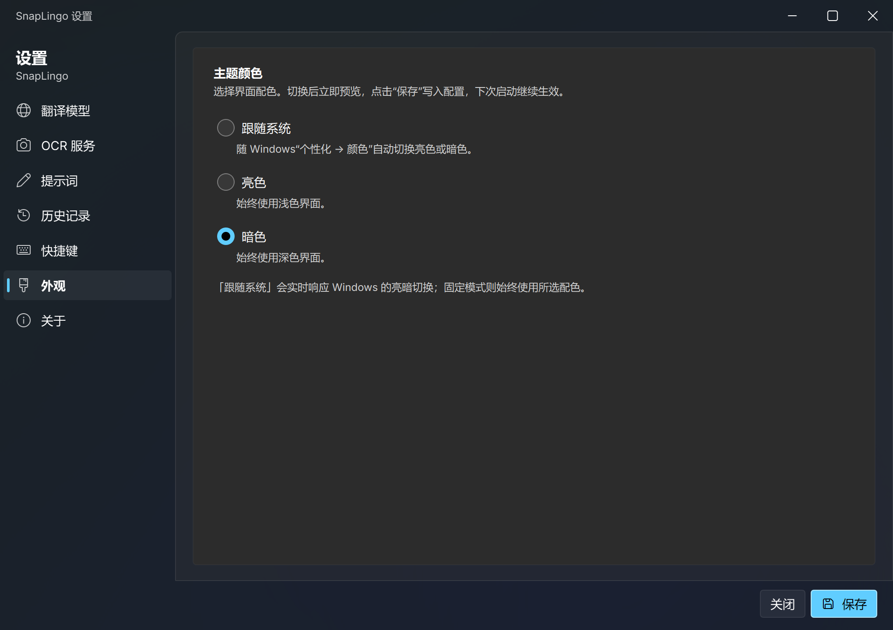

# SnapLingo

截图 → OCR 文字识别 → 多模型并发翻译的 Windows 桌面工具。

单一 C++20 / Qt 6 Widgets 实现，界面基于 [Fluent-Qt](https://github.com/calvinhxx/Fluent-Qt)（WinUI / Fluent 风格 Qt Widgets 组件库）：Fluent 标题栏、Mica 背景、`NavigationView` 设置页、Fluent 按钮 / 输入框 / 下拉框 / 列表与卡片，并提供亮色、暗色、跟随系统三种主题配色。
应用会把每次成功识别的截图和文字保存在本机，可在“历史”窗口按时间浏览、复制或删除。
完整解压便携 ZIP 后运行 `SnapLingo.exe`，无需另装 .NET、Qt 或 C++ 运行库。
当前 x64 Release 便携包实测约 **14.8 MiB ZIP / 37.3 MiB 解压后**（包含 Fluent-Qt 字体与图标资源）。

## 界面预览

| 主界面 | 翻译模型 |
| --- | --- |
|  |  |

| OCR 服务 | 截图与识别历史 |
| --- | --- |
|  |  |

| 外观（亮色） | 外观（暗色） |
| --- | --- |
|  |  |

关于页见 [docs/04_关于.png](docs/04_关于.png)。

## 功能特点

- **Fluent 界面** — Fluent-Qt 控件、`NavigationView` 设置页（带图标的导航项）、Fluent 标题栏与 Mica 背景
- **主题配色** — 设置 → 外观中可选亮色、暗色或跟随系统；切换即时生效，随 Windows 亮暗设置自动跟随
- **即时反馈** — 保存设置、切换主题、设为当前 OCR 时以 Fluent Toast 提示结果
- **全局快捷键截图** — 默认 `Ctrl+Shift+A`，可自定义
- **桌面选区与放大镜** — 精确选取截图边缘，`Esc` 或右键取消
- **多种 OCR 引擎** — Windows 本地 OCR、火山引擎、百度 OCR、腾讯云 OCR
- **多模型并发翻译** — 支持任意 OpenAI 兼容 API，同时对比多个模型结果
- **截图与识别历史** — 本机保存截图和识别文字，可浏览、复制、删除、清空，默认保留 100 条
- **流式输出与思考模式** — 单次请求可开关模型思考模式
- **自定义翻译提示词** — 灵活配置翻译策略
- **开机自启动** — 可选，默认关闭
- **系统托盘常驻** — 托盘菜单可直接截图、打开历史、打开设置或退出，不占用任务栏空间

## 使用说明

1. 下载 [最新 Release](https://github.com/zouchanglin/SnapLingo/releases) 中的 Qt 便携包，解压后运行 `SnapLingo.exe`
2. 首次运行后，右键系统托盘图标进入“设置”
3. 在“模型配置”中添加 OpenAI 兼容 API（如通义千问、DeepSeek、OpenAI 等）
4. 在“OCR”中配置 OCR 服务（Windows 本地 OCR 开箱即用，无需配置）
5. 按下快捷键（默认 `Ctrl+Shift+A`）开始截图翻译
6. 在结果窗口中可编辑识别文本，`Enter` 重新翻译，`Shift+Enter` 换行
7. 主窗口右上角的“历史”或托盘菜单的“历史记录”都可浏览截图与识别文字；设置 → 历史记录可开关记录、调整保留条数或清空
8. 设置 → 外观可切换亮色 / 暗色 / 跟随系统，切换立即预览并给出 Toast 提示，保存后下次启动继续生效

设置保存在 `%APPDATA%\SnapLingo\settings.json`；兼容旧版配置，首次保存前会备份为 `settings.json.pre-qt.bak`。
主题选择以 `Theme` 字段保存（`System` / `Light` / `Dark`）；选择“跟随系统”时随 Windows 亮暗设置自动切换。
历史记录保存在 `%APPDATA%\SnapLingo\history`，只在本机读写。
Windows 本地 OCR 需要系统安装相应语言包；云服务需要自行配置密钥。

## 系统要求

- Windows 10 1809+ / Windows 11，x64
- 无需 .NET、Qt 或 Visual C++ 运行库（便携包已包含）
- Windows 11 上使用系统 Mica 背景，Windows 10 使用 Fluent 绘制的回退背景
- Windows OCR 需要对应语言包；云 OCR / 翻译需要自备 API 凭据

## 开源协议

[MIT License](LICENSE)。Fluent-Qt 采用 MIT 协议，其捆绑字体与图标的第三方声明见 `third_party/fluentqt/THIRD_PARTY_NOTICES.md`。
